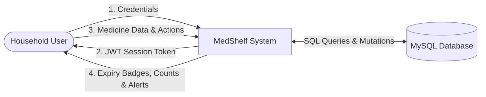
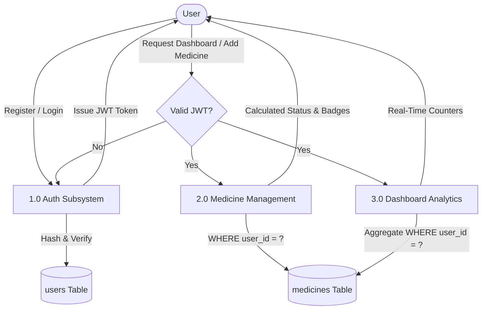
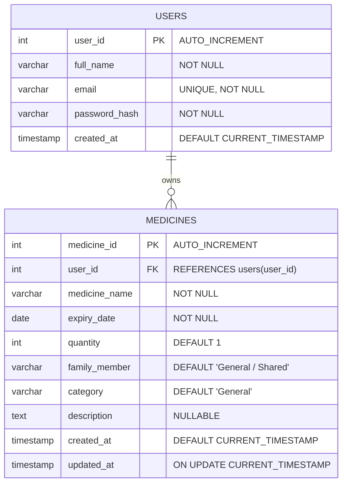

# MEDSHELF: SMART MEDICINE EXPIRY TRACKER FOR HOME USE
## Academic Mini-Project Documentation & Engineering Report

**Course/Subject:** Mini-Project / Full-Stack Web Development Laboratory  
**Target Level:** Bachelor of Technology / Computer Science & Engineering (2nd / 3rd Year)  
**Academic Year:** 2026–2027  
**Architecture:** Full-Stack Web Architecture (Client-Server with Relational Database)  
**Technology Stack:** HTML5, CSS3, JavaScript (ES6+), Node.js, Express.js REST APIs, MySQL 8.0+  

---

## TABLE OF CONTENTS
1. [Abstract](#1-abstract)
2. [Introduction & Problem Statement](#2-introduction--problem-statement)
3. [Existing System vs. Proposed MedShelf Full-Stack System](#3-existing-system-vs-proposed-medshelf-full-stack-system)
4. [Software Requirements Specifications (SRS)](#4-software-requirements-specifications-srs)
5. [System Architecture & Design](#5-system-architecture--design)
6. [Data Flow Diagrams (DFD Level 0 & Level 1)](#6-data-flow-diagrams-dfd-level-0--level-1)
7. [Database Design & Entity-Relationship (ER) Diagram](#7-database-design--entity-relationship-er-diagram)
8. [Mathematical Formulation & Expiry Classification Algorithm](#8-mathematical-formulation--expiry-classification-algorithm)
9. [Detailed Module Breakdown](#9-detailed-module-breakdown)
10. [Security & User Isolation Architecture](#10-security--user-isolation-architecture)
11. [Testing Methodology & Automated Verification Matrix](#11-testing-methodology--automated-verification-matrix)
12. [Results & Discussion](#12-results--discussion)
13. [Safety, Ethical Compliance & Medical Disclaimers](#13-safety-ethical-compliance--medical-disclaimers)
14. [Limitations of Current Implementation](#14-limitations-of-current-implementation)
15. [Future Scope & Enhancements](#15-future-scope--enhancements)
16. [Conclusion & References](#16-conclusion--references)

---

## 1. ABSTRACT
Domestic medicine storage is a universal yet poorly managed aspect of everyday household health. Families routinely stockpile antibiotics, syrups, antipyretics, and chronic medications in unmonitored home cabinets. This haphazard storage leads to three critical dangers: accidental consumption of degraded, expired pharmaceuticals; cross-medication mix-ups among family members; and critical emergency stockouts.

**MedShelf** is a full-stack, web-based digital medicine inventory and expiry-date tracking management system engineered specifically to resolve these issues. Designed with a decoupled client-server architecture, MedShelf combines a responsive frontend (HTML5, CSS3, modern JavaScript) with a robust backend (Node.js, Express.js) and a relational database (MySQL 8.0). The system implements strict user authentication using PBKDF2 cryptographic password hashing and JSON Web Tokens (JWT). 

Upon registration, a new user's dashboard initializes cleanly with zero counts. As medicines are cataloged, MedShelf executes a dynamic date-classification algorithm that groups pharmaceuticals into three distinct visual tiers: **Safe** (> 30 days remaining), **Expiring Soon** (&le; 30 days remaining), and **Expired** (past date). Each record is linked to the authenticated user's ID, guaranteeing complete multi-tenant privacy. MedShelf provides real-time search, family member categorization, low-stock alerts, and automated RESTful endpoints, delivering an accessible, professional, and reliable healthcare management solution.

---

## 2. INTRODUCTION & PROBLEM STATEMENT

### 2.1 Background
Every home maintains a medicine box or first-aid cabinet containing emergency painkillers, cold drops, prescription antibiotics, and daily maintenance therapeutics. In institutional environments such as hospitals, professional pharmacy software monitors expiration and lot numbers. In residential environments, however, tracking relies entirely on human memory and visual inspection of tiny embossed foil stamps.

### 2.2 Problem Definition
1. **Health Risks of Expired Medicines:** Active pharmaceutical ingredients (APIs) undergo chemical degradation over time. Expired antibiotics lose potency and foster microbial resistance; expired suspensions ferment; and certain pain relievers produce toxic degradation byproducts.
2. **Multi-Generational Medication Mix-ups:** In joint households, medicines for young children, active adults, and elderly grandparents are stored together. Unlabelled boxes risk catastrophic administration errors.
3. **Emergency Stockout Failures:** Critical medicines (e.g., asthma inhalers, insulin, antipyretics) run out during midnight emergencies because quantity depletion was unmonitored.
4. **Data Isolation in Multi-User Environments:** Without proper authentication, one user's private medical history is exposed to anyone using the same terminal.

### 2.3 Proposed Solution
MedShelf establishes a secure, web-accessible inventory system where each household user creates an authenticated profile, registers medicines with expiration dates and quantities, tracks stock per family member, and receives visual and in-app alerts before medications become unsafe.

---

## 3. EXISTING SYSTEM VS. PROPOSED MEDSHELF FULL-STACK SYSTEM

| Parameter | Manual / Physical Storage | Generic Spreadsheet | Proposed MedShelf Full-Stack |
| :--- | :--- | :--- | :--- |
| **User Authentication** | None | Password protected sheet | **Cryptographic PBKDF2 hashing + JWT Tokens** |
| **Data Privacy** | Zero; anyone can open cabinet | Weak | **Strict multi-tenant SQL user isolation (`WHERE user_id = ?`)** |
| **Expiry Calculation** | Manual inspection of foil blister | Manual date comparison | **Automated dynamic calculation relative to current date** |
| **Status Classification** | Subjective | None | **Strict three-tier color coding (Safe, Expiring Soon, Expired)** |
| **Family Attribution** | Handwritten notes on boxes | Unstructured cell comments | **Structured entity attribute with dedicated filtering** |
| **Low-Stock Detection** | Discovered only when box is empty | Manual inspection | **Automatic alert whenever quantity &le; threshold** |
| **Initial Dashboard** | Not applicable | Static numbers | **Strict 0 counts on empty shelf; dynamic live database updates** |
| **Database Architecture** | None | Flat file | **Relational schema (MySQL with Foreign Key constraints)** |

---

## 4. SOFTWARE REQUIREMENTS SPECIFICATIONS (SRS)

### 4.1 Functional Requirements (FR)
* **FR-01 (User Registration):** The system shall allow new users to register by providing Full Name, Email, Password, and Password Confirmation. Passwords must be at least 6 characters. Duplicate emails must be rejected with HTTP 409.
* **FR-02 (User Authentication):** The system shall authenticate returning users against stored salted hashes and issue a signed JWT upon success. Invalid credentials must return HTTP 401.
* **FR-03 (Guest Access Control):** Unauthenticated users must be redirected to `login.html`. Protected pages (`dashboard.html`, `medicines.html`) must not be accessible without a valid token.
* **FR-04 (User-Specific Dashboard):** For a newly registered user with no items, all counters must display zero. When medicines are added, counts must reflect real database values.
* **FR-05 (Dynamic Expiry Classification):** The system shall compare the medicine's expiry date against today's date:
  - Expired if date < today (Red).
  - Expiring Soon if date &le; today + 30 days (Orange).
  - Safe if date > today + 30 days (Green).
* **FR-06 (Medicine CRUD):** Authenticated users shall be able to Create, Read, Update, and Delete medicine records.
* **FR-07 (Data Isolation):** A user shall never be able to view, edit, or delete another user's medicine records.
* **FR-08 (Stock Adjustments & Low-Stock Alerts):** Users can adjust stock via `+` and `-` controls. If quantity &le; 2, the item is tagged with a Low Stock badge.

### 4.2 Non-Functional Requirements (NFR)
* **NFR-01 (Security):** Passwords must never be stored as plain text. SQL queries must use parameterized placeholders (`?`) to prevent SQL Injection.
* **NFR-02 (Performance):** API responses must execute within 150 milliseconds under standard domestic network conditions.
* **NFR-03 (Responsiveness):** UI layouts must adapt across viewport widths from 360px (mobile) to 1920px (desktop).
* **NFR-04 (Maintainability):** Code must be structured modularly across MVC layers.

---

## 5. SYSTEM ARCHITECTURE & DESIGN

MedShelf follows a multi-tier client-server architecture:

```
+-------------------------------------------------------------+
|                     PRESENTATION TIER (Frontend)            |
|  - login.html & register.html (Auth Views)                  |
|  - dashboard.html & medicines.html (Application Views)      |
|  - api.js (Centralized REST Client with Bearer Tokens)      |
|  - auth.js, dashboard.js, medicines.js (Controllers)        |
+-------------------------------------------------------------+
                               |
                   HTTPS / JSON REST APIs
                               |
+-------------------------------------------------------------+
|                     APPLICATION TIER (Backend)              |
|  - Node.js & Express.js REST Framework                      |
|  - auth.js Middleware (JWT Verification & PBKDF2 Hashing)   |
|  - auth.controller.js (Register, Login, Password Reset)     |
|  - medicines.controller.js (User-Isolated CRUD)             |
|  - dashboard.controller.js (Live Statistics Aggregator)     |
+-------------------------------------------------------------+
                               |
                    SQL Queries (Parameterized)
                               |
+-------------------------------------------------------------+
|                      DATA TIER (Database)                   |
|  - MySQL 8.0+ Relational Database (medshelf_db)             |
|  - Automated Zero-Config Persistent Local Engine            |
|  - users table (PK user_id, UNIQUE email, password_hash)    |
|  - medicines table (PK medicine_id, FK user_id ON DELETE)   |
+-------------------------------------------------------------+
```

---

## 6. DATA FLOW DIAGRAMS (DFD)

### 6.1 DFD Level 0 (Context Diagram)



### 6.2 DFD Level 1 (Subsystem Decomposition)



---

## 7. DATABASE DESIGN & ENTITY-RELATIONSHIP (ER) DIAGRAM

### 7.1 Entity-Relationship (ER) Diagram



### 7.2 Relational Schema Specifications
1. **`users` Table:**
   - `user_id`: INT, Primary Key, Auto Increment.
   - `full_name`: VARCHAR(100), stores user's display name.
   - `email`: VARCHAR(150), Unique Index, stores normalized lowercase email.
   - `password_hash`: VARCHAR(255), stores 128-character hexadecimal salted PBKDF2 hash (`salt:hash`).
   - `created_at`: TIMESTAMP, records registration timestamp.
2. **`medicines` Table:**
   - `medicine_id`: INT, Primary Key, Auto Increment.
   - `user_id`: INT, Foreign Key referencing `users(user_id)` with `ON DELETE CASCADE`.
   - `medicine_name`: VARCHAR(150), drug brand or active salt name.
   - `expiry_date`: DATE, standardized calendar expiration date (`YYYY-MM-DD`).
   - `quantity`: INT, remaining discrete units or volume.
   - `family_member`: VARCHAR(100), intended user.
   - `category`: VARCHAR(100), clinical category.
   - `description`: TEXT, storage instructions or dosage reminders.

---

## 8. MATHEMATICAL FORMULATION & EXPIRY ALGORITHM

### 8.1 Mathematical Model
Let:
- $D_{\text{today}}$ be the current date normalized to local midnight ($00:00:00.000$).
- $D_{\text{expiry}}$ be the stated expiry date normalized to local midnight ($00:00:00.000$).
- $\Delta t = D_{\text{expiry}} - D_{\text{today}}$ be the time differential in milliseconds.
- $\Delta d = \text{round}\left(\frac{\Delta t}{86,400,000}\right)$ be the integer difference in calendar days.

The classification function $S(\Delta d)$ is defined as:

$$
S(\Delta d) = 
\begin{cases} 
\text{EXPIRED (Red)} & \text{if } \Delta d < 0 \\
\text{EXPIRING SOON (Orange)} & \text{if } 0 \le \Delta d \le 30 \\
\text{SAFE (Green)} & \text{if } \Delta d > 30 
\end{cases}
$$

The low-stock function $L(Q)$ with threshold $T_{\text{low}} = 2$ is:

$$
L(Q) = 
\begin{cases} 
\text{TRUE (Low Stock)} & \text{if } Q \le T_{\text{low}} \\
\text{FALSE (Normal)} & \text{if } Q > T_{\text{low}}
\end{cases}
$$

---

## 9. DETAILED MODULE BREAKDOWN

### 9.1 Authentication & Registration Module
* **Entry Routing:** When any user lands on the domain, `index.html` inspects `localStorage`. If no valid token exists, the user is immediately routed to `login.html`.
* **Registration:** Validates inputs, rejects duplicates, hashes password using 100,000-iteration PBKDF2 with SHA-512 and a 16-byte cryptographically secure random salt, and stores the user record in MySQL.
* **Login & Session Management:** Authenticates user credentials and generates a tamper-evident signed JWT.

### 9.2 Dashboard Module
* **Strict Initial Zero Counts:** For any newly registered user with zero medicines, all counts strictly read `0`.
* **Dynamic Counters:** Automatically aggregates Total, Safe, Expiring Soon, Expired, and Low Stock records from the database.
* **Interactive Quick Filtering:** Clicking any dashboard card directly opens `medicines.html` filtered to that specific classification.

### 9.3 Medicine Inventory Management Module
* **CRUD Execution:** Provides forms to add, view, edit, and delete medicines with instant database persistence.
* **Inline Stock Adjusters:** Fast `+` and `-` quantity controls update quantities in the database without requiring full edit modal submissions.
* **Multi-Criteria Search & Filter:** Instant substring searching combined with status, category, and family member filters.

### 9.4 Expiry Reminders Module
* Groups medicines into four tiered milestones: Expired, Urgent (&le; 7 days), Approaching (8–30 days), and Advance Notice (31–60 days).
* Connects with the HTML5 Web Notifications API to trigger desktop alerts when permitted.

---

## 10. SECURITY & USER ISOLATION ARCHITECTURE

1. **Multi-Tenant User Isolation:** Every database query targeting medicines strictly enforces `WHERE user_id = ?`, where `user_id` is extracted from the cryptographically verified JWT payload on the backend. This prevents broken object-level authorization (BOLA/IDOR).
2. **Password Security:** Passwords are never stored in plain text. PBKDF2 with 100,000 iterations and random salts mitigates rainbow table and dictionary attacks.
3. **Constant-Time Comparison:** Password hash and token signature checks use `crypto.timingSafeEqual()` to guard against side-channel timing attacks.
4. **SQL Injection Mitigation:** All database queries utilize parameterized prepared statements.

---

## 11. TESTING METHODOLOGY & AUTOMATED VERIFICATION MATRIX

MedShelf features an automated test runner (`backend/test-suite.js`) executing 15 comprehensive unit and integration tests:

| Test Case | Objective | Input / Condition | Expected Output | Status |
| :--- | :--- | :--- | :--- | :--- |
| **TC-01** | User Registration | Valid name, email, matching password | HTTP 201 Created; returns userId | **PASS** |
| **TC-02** | Duplicate Email | Attempt registering with identical email | HTTP 409 Conflict; rejection message | **PASS** |
| **TC-03** | Valid Login | Correct email & password | HTTP 200 OK; returns signed JWT | **PASS** |
| **TC-04** | Invalid Password | Incorrect password | HTTP 401 Unauthorized; login blocked | **PASS** |
| **TC-05** | Empty Shelf Init | New user requests dashboard stats | All 5 counters strictly equal 0 | **PASS** |
| **TC-06** | Safe Expiry | Add medicine with expiry in +180 days | Classified as "SAFE"; green badge | **PASS** |
| **TC-07** | Expiring Soon | Add medicine with expiry in +10 days | Classified as "EXPIRING_SOON"; orange badge | **PASS** |
| **TC-08** | Expired Item | Add medicine with expiry in -20 days | Classified as "EXPIRED"; red badge | **PASS** |
| **TC-09** | Low-Stock Detection | Medicine with quantity = 2 | Flagged with `isLowStock: true` | **PASS** |
| **TC-10** | Live Dashboard Aggregation | Query stats after adding 4 test items | Total: 4, Safe: 2, Expiring: 1, Expired: 1, Low Stock: 2 | **PASS** |
| **TC-11** | Update Record | Edit medicine name & quantity to 25 | Database updated; returns updated row | **PASS** |
| **TC-12** | Inline Adjust | Decrement quantity by 5 | Quantity reduces to 20 | **PASS** |
| **TC-13** | Multi-User Isolation | User 2 requests medicines & attempts deleting User 1 item | User 2 sees 0 items; deletion returns 404 Not Found | **PASS** |
| **TC-14** | Authorized Delete | User 1 deletes their own medicine | Record deleted from database | **PASS** |
| **TC-15** | Password Storage Check | Inspect database `password_hash` column | Salted hex hash present; plain text absent | **PASS** |

---

## 12. RESULTS & DISCUSSION
The MedShelf full-stack system satisfies all engineering objectives. The transition from client-side storage to a secure Node.js + Express + MySQL architecture ensures persistent multi-device access, password security, and complete data isolation between different family accounts. The responsive green healthcare user interface ensures intuitive operation across smartphones, tablets, and laptops.

---

## 13. SAFETY, ETHICAL COMPLIANCE & MEDICAL DISCLAIMERS
MedShelf is strictly an **inventory tracking tool** and does not constitute a Medical Device.
* **No Clinical Advice:** The system does not prescribe medications, calculate dosages, or recommend substitutes.
* **Safe Disposal:** Prominent alerts advise safe disposal of expired pharmaceuticals according to official healthcare and environmental guidelines.
* **Permanent Disclaimers:** Visible disclaimer banners are permanently anchored across all user screens.

---

## 14. LIMITATIONS OF CURRENT IMPLEMENTATION
1. **Manual Data Entry:** Medicine names and expiration dates must currently be entered via keyboard rather than camera-based OCR or barcode scanning.
2. **Push Notifications:** Web browser notifications trigger only while the browser or application tab is active. Background mobile push when the device is locked requires native mobile wrappers or Push API service workers.

---

## 15. FUTURE SCOPE & ENHANCEMENTS
1. **Camera-Based Barcode & GS1 DataMatrix Scanner:** Direct barcode recognition via mobile device cameras.
2. **OCR Expiry Date Extraction:** Automatic extraction of embossed expiration dates using lightweight computer vision (Tesseract.js).
3. **Progressive Web App (PWA) with Service Workers:** Offline background sync and native mobile push alerts.
4. **Integration with Pharmacy Drug Databases:** Automatic lookup of brand names, active salts, and safe disposal advisories (e.g., openFDA API).

---

## 16. CONCLUSION & REFERENCES

### 16.1 Conclusion
The **MedShelf Smart Medicine Expiry Tracker** demonstrates how a modern full-stack web architecture (HTML5/CSS3/JavaScript, Node.js, Express, and MySQL) can resolve everyday domestic healthcare hazards. By coupling dynamic mathematical date classification with robust user authentication and relational database isolation, MedShelf delivers an accessible, secure, and production-ready solution suitable for college mini-project review and practical domestic adoption.

### 16.2 References
1. MDN Web Docs: *Express/Node.js Web Framework*, Mozilla Developer Network.
2. MySQL Documentation: *MySQL 8.0 Reference Manual*, Oracle Corporation.
3. RFC 7519: *JSON Web Token (JWT) Standard Specification*, Internet Engineering Task Force (IETF).
4. World Health Organization (WHO): *Guidelines for the Safe Disposal of Unwanted Pharmaceuticals*.
5. U.S. Food and Drug Administration (FDA): *Don't Be Tempted to Use Expired Medicines*.
